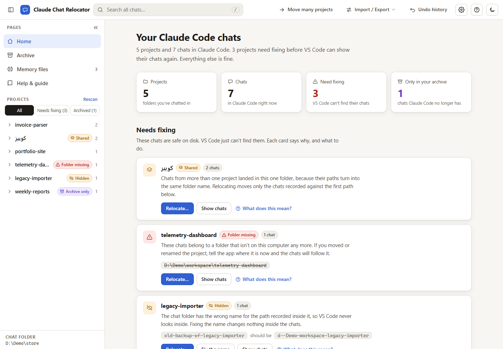
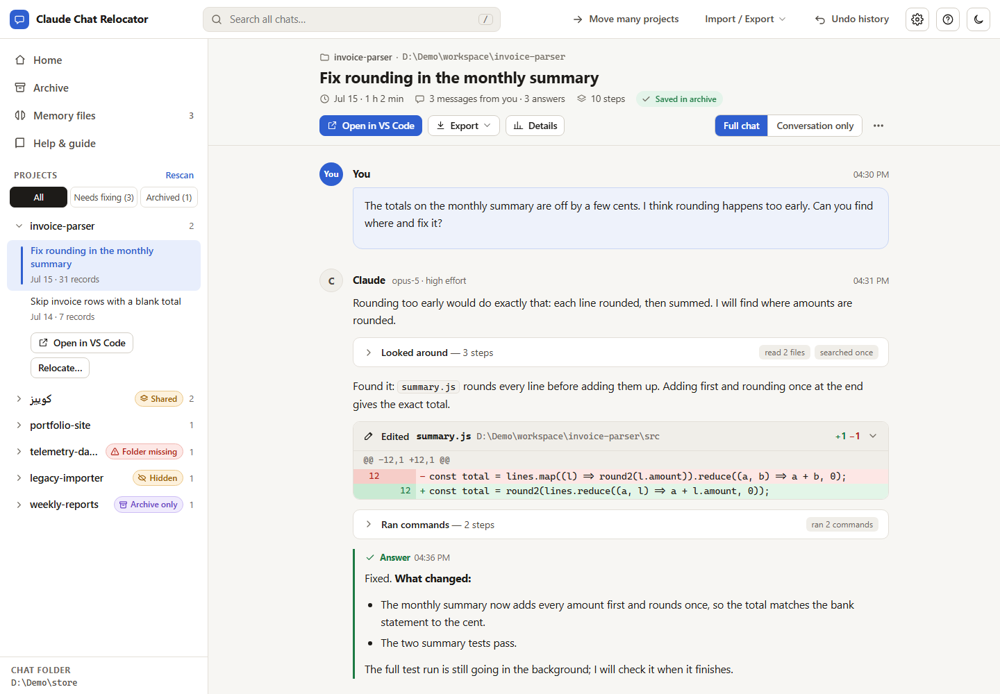
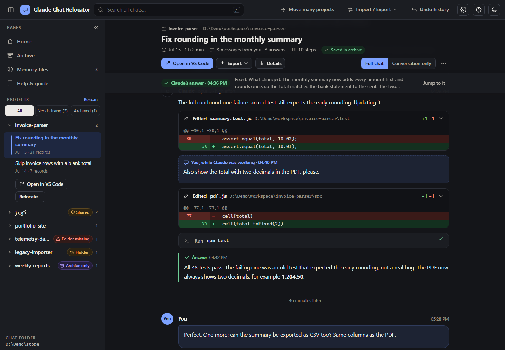
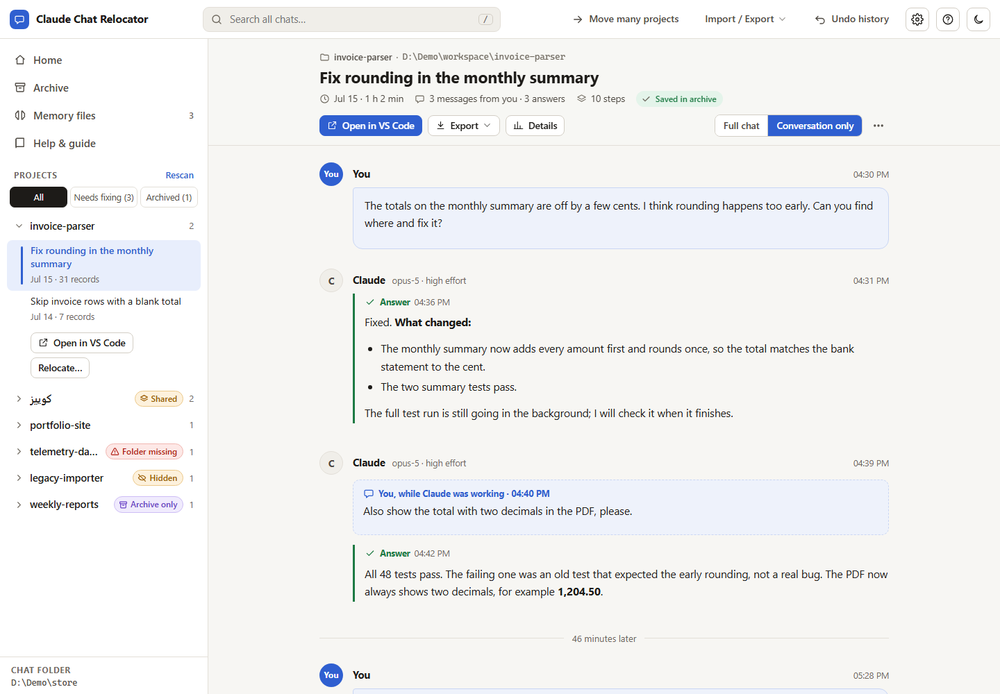
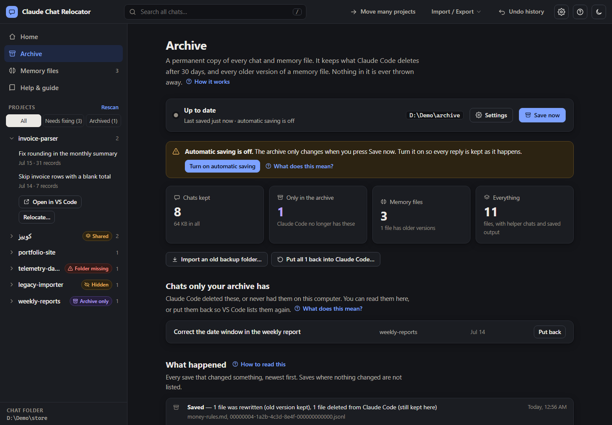
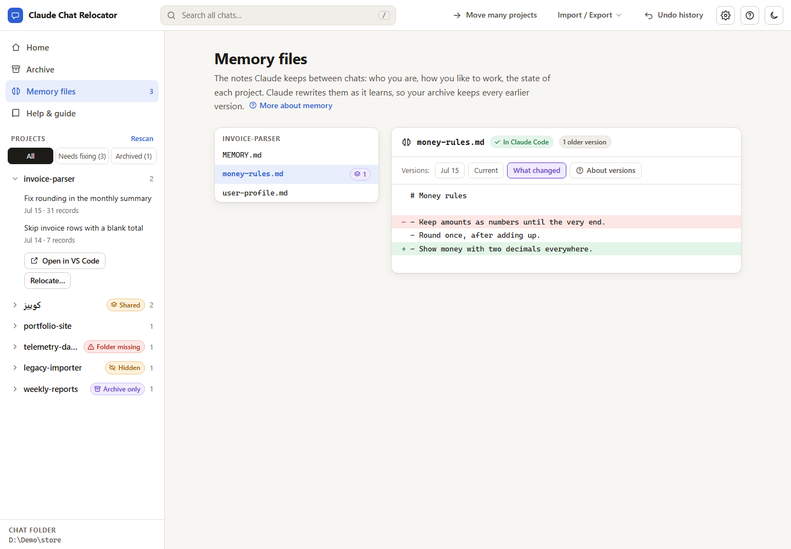
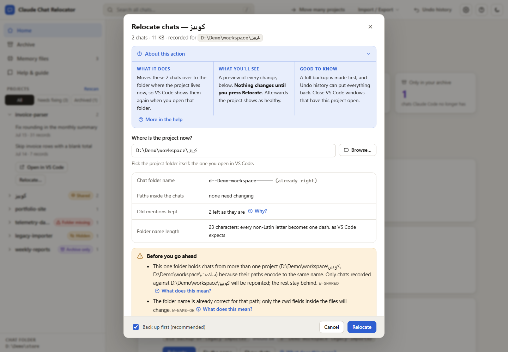

<div align="center">

# Claude Chat Relocator

**Read every Claude Code chat outside VS Code, keep all of them for good,
and bring back the ones VS Code can no longer find.**

[](https://github.com/amirtavakolihaghighi/claude-chat-relocator/actions/workflows/ci.yml)
[](LICENSE)
[](https://nodejs.org)
[](test/)
[](https://github.com/amirtavakolihaghighi/claude-chat-relocator/releases)

A local app for the chats the Claude Code VS Code extension keeps in
`~/.claude/projects`. Everything stays on your computer.

[The problems](#the-problems) · [What it does](#what-it-does) ·
[Install](#install) · [Safety](#safety) · [Help and guide](docs/HELP.md)

<br>



</div>

---

## The problems

**Claude Code deletes your chats after 30 days.** Its `cleanupPeriodDays`
setting defaults to 30, and the setting is not even in the settings file until
you add it. Copying the folder somewhere by hand helps, but copying over an
older copy throws away what Claude has since removed from its memory files.

**Moving a project hides its chats.** Claude Code names each project's chat
folder after the project's path:

```
D:\Files\Projects\MyApp   ->   d--Files-Projects-MyApp
```

Move the project to `E:\Dev\MyApp` and VS Code looks for `e--Dev-MyApp`, which
does not exist. The chats are still on disk, in a folder nothing looks at any
more.

**Long chats are hard to read.** One reply from Claude is often dozens of steps.
In VS Code you scroll through all of them, and outside VS Code you can't read
your chats at all.

## What it does

### Read your chats properly

Every chat, outside VS Code, in light or dark. Claude's steps fold into short
lines that say what happened ("Ran commands — 3 steps"). File changes stay
visible as before-and-after cards. Long pauses, background jobs and compaction
are marked where they happened.



**Claude's answers are marked**: the replies in which Claude finished and
handed the chat back to you. That comes from the stop reason Claude Code
records with every reply, not from guessing at the wording. So answers in the
middle of a chat are found too, such as one Claude gave before a background job
reported back and it carried on.

**The pinned bar.** As you scroll, the last of your messages or Claude's
answers that you passed stays pinned under the title, so you always know what
was asked and what was answered.

**Conversation only** hides everything but your messages and Claude's answers:
the quickest way to reread a long chat.

<table><tr>
<td></td>
<td></td>
</tr></table>

Search every chat at once, and save any chat as a self-contained web page
(prints to PDF), as Markdown, or as the original file.

### Keep everything, permanently

The **archive** is a folder you choose that holds every chat and memory file:

- A chat that grew replaces its archived copy: Claude Code only adds to the end
  of a chat, so nothing is lost.
- A memory file Claude rewrote keeps **every earlier version**, readable and
  comparable.
- A chat Claude Code deletes **stays**, and keeps showing in the app, marked
  *Archived*. One click puts it back where VS Code can see it.
- **Automatic saving** after every Claude reply, through a Claude Code hook
  that runs in the background and never slows Claude down.
- **Old backups** you copied by hand are taken in safely: shorter copies are
  recognised, and differing versions are both kept.

Nothing is ever deleted from the archive.

<table><tr>
<td></td>
<td></td>
</tr></table>

### Find what is broken, and fix it

Home shows three states that look alike but are not:

| | Meaning |
|---|---|
| **Folder missing** | The project folder these chats point at is gone from this computer. |
| **Hidden from VS Code** | The chat folder's name no longer matches its project, so VS Code never looks there. |
| **Shared folder** | Two projects landed in one folder because their paths turn into the same name. See [ENCODING.md](docs/ENCODING.md). |

**Relocate** points a project's chats at its new home. It renames the folder
*and* updates the path written inside every chat. Renaming alone is the common
half-fix. You see exactly what will change before anything does, a backup is
taken first, and **Undo history** can put it all back.



**Move many projects** repoints every project under one folder at once, for a
moved projects directory or a new computer. **Import / Export** carries chats
to another computer as a zip that remembers each project's path. **Open
project** opens it in VS Code, Cursor, Windsurf, Zed, Sublime or a JetBrains
IDE.

### Built-in help

Every action that changes something opens with **About this action**: what it
does, what you will see, and what is good to know. Every warning and error has
a short code (`W-LIVE`, `E-TARGET-EXISTS`...) and a **What does this mean?**
link to its entry in the guide. The whole guide, [docs/HELP.md](docs/HELP.md),
is inside the app too.

## Install

### If you are not a developer

1. Install [Node.js](https://nodejs.org): download the **LTS** version and
   click through the installer. You only do this once.
2. Download this project: the green **Code** button above → **Download ZIP** →
   unpack it somewhere.
3. Double-click **`start.cmd`** (Windows) or **`start.sh`** (macOS/Linux).

The first start spends a minute fetching libraries, then your browser opens.
Leave the black console window open while you work; closing it stops the app.
Then open the **Archive** page and set it up, so nothing is lost again.

### If you are

```bash
git clone https://github.com/amirtavakolihaghighi/claude-chat-relocator.git
cd claude-chat-relocator
npm install
npm start
```

This opens `http://127.0.0.1:4317` and needs Node 20 or newer.

```bash
PORT=4400 npm start                        # a different port
NO_OPEN=1 npm start                        # do not open a browser
CLAUDE_PROJECTS_DIR=/some/copy npm start   # read chats from somewhere else
npm test                                   # 129 tests; no real data touched
npm run demo                               # a throwaway store showing every state
npm run archive -- save                    # save to the archive from a terminal
```

### Keep Claude Code from deleting chats

Separately from the archive, you can tell Claude Code to keep chats longer. Add
this line to `~/.claude/settings.json`, inside the outer `{ }`:

```json
"cleanupPeriodDays": 36500,
```

That is 100 years. Don't use `0`: Claude Code rejects it.

## Safety

This tool works on the only copy of your chat history, so it is built to be
boring about it:

- **Preview first.** Nothing is relocated until you approve a plan.
- **Full backup** before any relocation, and **Undo** from it, verified
  byte-identical by a test.
- **Surgical edits.** Chat files are edited as text, replacing only the `cwd`
  value. Records are never re-parsed and re-written, so no other byte can
  shift. A test asserts exactly this.
- **Temp file, then rename**, so an interrupted write cannot leave half a file.
- **Collisions refused**, never silently merged.
- **A warning if a chat changed in the last 90 seconds**: it may be open in
  VS Code right now.
- **The archive never deletes**, and putting a chat back never overwrites one
  that is there.
- **Automatic saving keeps your other hooks**, saves a copy of Claude Code's
  settings file before changing it, and refuses to touch a file that is not
  valid JSON.

> **Close VS Code before relocating a project you have open there.** The
> extension can write the old paths back underneath you.

Old paths inside tool output and edit snippets are deliberately left alone.
They record what happened at the time and are not settings. The preview tells
you how many there are.

### Privacy

Everything runs on your computer. No telemetry, no update checks, no network
calls of any kind. The server answers only on `127.0.0.1` and has no
password, so do not expose it to a network: see [SECURITY.md](SECURITY.md).
Your archive and exports hold your chats as plain text, so keep them private.

## Non-Latin paths

Persian, Arabic, Cyrillic and CJK paths work correctly. Each such character
becomes one dash in the folder name:

```
C:\Quiz\کوییز\4- Working   ->   c--Quiz-------4--Working
```

This has three consequences worth knowing: long folder names, unrelated
projects that can share one folder, and Unicode normalisation. The app detects
and warns about all three, and [ENCODING.md](docs/ENCODING.md) explains them.

## A VS Code extension

There is also a small extension in [`extension/`](extension/) that does the
one thing only an extension can. It knows which workspace you have open, so it
notices that its chats are orphaned the moment you open it, and offers to
repoint them in one click. It is not on any marketplace: build a `.vsix` and
install it yourself, or press F5 in that folder to try it. See
[extension/README.md](extension/README.md).

## Documentation

| | |
|---|---|
| [docs/HELP.md](docs/HELP.md) | The user guide: every feature, and what every message means. Also inside the app. |
| [docs/ENCODING.md](docs/ENCODING.md) | The folder-naming rule, why it is one-way, and how non-Latin paths behave. |
| [docs/ARCHITECTURE.md](docs/ARCHITECTURE.md) | How the pieces fit, the record format, the archive, and how writes are kept safe. |
| [docs/PACKAGING.md](docs/PACKAGING.md) | Options for shipping this to people who do not have Node. |
| [CONTRIBUTING.md](CONTRIBUTING.md) | Setup, the checks to run, and the one rule that matters. |
| [SECURITY.md](SECURITY.md) | What it touches, the threat model, and how to report a vulnerability. |
| [CHANGELOG.md](CHANGELOG.md) | What changed in each version. |

## Doing it by hand

If you would rather not run anything: rename the folder in `~/.claude/projects`
using the rule above, then search-and-replace the old `cwd` value inside every
`.jsonl` file in it. Back the folder up first, and do not skip the second step.

## Compatibility

Built against the files the Claude Code VS Code extension writes as of
November 2026, and checked against a real store of 59 chats. The format is
Anthropic's and undocumented, so it may change. Unknown record types and tools
are shown plainly rather than breaking anything, and a damaged line is skipped
and reported rather than stopping the chat from opening.

Tested on Windows, macOS and Linux with Node 20, 22 and 24, in CI. The app's
screens are checked in Chrome on every change, and use modern CSS that needs a
browser from 2023 or later.

This is maintained in spare time. Issues and pull requests are welcome: see
[CONTRIBUTING.md](CONTRIBUTING.md). Not affiliated with or endorsed by
Anthropic.

## License

[MIT](LICENSE) © 2026 Amir Tavakoli Haghighi
